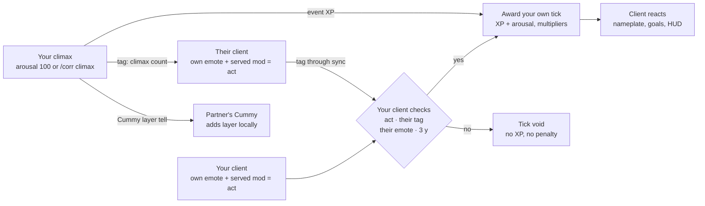

# Corruption — FFXIV Dalamud Plugin Design Doc

Nov 6, 2026 · Thiago

## Overview and goals

Corruption (working name) is a Dalamud plugin that ports the Second Life corruption HUD to FFXIV: two nearby players with the plugin gain XP while each plays an animation known to their own plugin, level up through corruption tiers, prestige at the cap, and show it off through nameplate text, visual marks and watcher bonuses.

Everything runs locally. There is no server and no pairing: clients find each other through a small SimpleHeels tag, and each decides for itself whether a scene is earning. The first playable version is specified in `openspec/changes/corruption-v1`; this doc also covers what comes after it.

It keeps the SL HUD's signature mechanics: an arousal meter with auto-climax, corruption that spreads from partner to partner, and corruption that fades if you stay away. Cummy (your plugin) layers the partner on every climax.

**v1 goals**

- No pairing: two players with the plugin who are synced and in an animation beside each other just earn, with a safeword to stop.
- Detection of known animations from the Penumbra mods actually served to your character, with each client checking its own side and what it can see of the partner.
- XP ticks while a verified scene runs, with own tier, partner, watcher, streak, difficulty and prestige multipliers.
- Levels 1–100 in named tiers, prestige 1–10 with permanent bonuses.
- An arousal meter that climaxes automatically at 100 and layers the partner through Cummy. Text above nameplates that shows tier and live arousal, tier visuals through Glamourer or Penumbra, and an optional ImGui HUD.

**Out of scope for v1**

- Leaderboards and public profiles, and voyeur XP. These need shared state that a local plugin doesn't have.
- NPC or solo XP. Playing alone earns nothing.
- Groups of three or more (the scene model allows N participants, but v1 verifies pairs only).

## Platform constraints

Everything happens on the client, and nothing checks one client's progress against another's. XP is trust-based: a modified client or an edited save can cheat. That's accepted for a hobby plugin.

- **Each client reports only on itself.** My plugin knows which Penumbra mods change my character and which emote I'm playing. It can see your emote and position from the object table, but not which animation mod your client applies. So your plugin declares your act in its tag, and my plugin checks the emote it can see against that.
- **Visibility to others.** Visuals (Glamourer/Penumbra) and animations reach other players only through Mare successors (Snowcloak, Lightless), and nothing in this plugin sends mod files. Nameplate text is drawn by the plugin, so only you and synced plugin users can see it.
- **Distribution.** The official Dalamud repo won't accept NSFW plugins. Ship it from a custom repo JSON on GitHub (`raylapetal` or `Thiagomn1`).
- **Discretion.** No chat output to public channels, ever. Everything is printed to the local echo channel or the HUD. The plugin sends no tells of its own. Nothing appears for players who don't have the plugin, apart from what sync tools already show.
- **Consent.** Corruption doesn't ask: being in an animation beside someone with the plugin is the opt-in. Either player can stop instantly, and a safeword hotkey stops the scene, XP and any linked effects, even if nobody else responds. Changing someone's character still needs consent, through a pairing in Cummy.

## Core loop

A scene earns XP every 10 seconds while two players with the plugin both play a known animation within 3 yalms of each other. Each client checks this for itself.

1. **Tag.** Once set up, each client publishes a short tag through SimpleHeels. Sync services deliver it to players they sync with. Having the tag is how another client knows you run Corruption.
2. **Detect.** Each client reads its own looping emote and asks Penumbra whether the file it serves belongs to a mod you picked.
3. **Declare.** When your act has held for 3 s, your tag names your emote. Nothing repeats while the scene runs unchanged.
4. **Verify.** Your client checks once a second: you're playing a known act, someone with a tag is within 3 yalms, their tag shows an act, and you can see them playing that emote. Their animation doesn't have to match yours.
5. **Award.** After 10 seconds of passing checks, your client adds its own tick of XP and arousal.
6. **React.** The client updates the nameplate text and HUD. On tier change it applies visuals.
7. **Events.** Climax (`/corr climax` at 70+, or automatically at 100 arousal) gives event XP and layers the partner through Cummy, if you're paired there.

When your act stops, your tag says so. If someone disappears, they're dropped as soon as they're no longer loaded. Partners' totals can differ by a tick or so, and nothing reconciles them.



The other client runs the same check from its side, so each only pays itself.

## Animation detection

An act counts as "known" when the emote playing on your character is replaced by a Penumbra mod you've picked from your own Penumbra folders.

**What is playing.** Read your own `Character` struct: the mode must be a loop, `ModeParam` gives the EmoteMode row, and `CPoseState` gives the variant for sit, ground sit and doze. Those variants are separate acts.

**Which mod drives it.** Each mod's `meta.json` lists its options and the game paths each one replaces, which gives candidates per option and pose. When your pose changes, when Penumbra raises `ModSettingChanged`, and every 5 s, call `ResolvePlayerPaths` with the paths of every picked mod's options for that pose, and find the option whose file is being served. This one check covers temporary settings (PoseKit plays animations that way), collection inheritance and priority conflicts.

**Choosing mods.** In the Acts page, step 1 lists your Penumbra folders and you tick the ones holding sex animations. Step 2 lists every animation mod in those folders, and you tick the ones that count. Every looping animation in a ticked mod counts, with no per-animation or per-mod settings, because packs like GoonersLife+ hold hundreds of animations. New mods added to a ticked folder appear as "new, not yet picked" until you decide.

**Partners' acts are independent.** Sex animations aren't always 1:1 between partners, so the check never compares them. Each player only needs an animation known on their own plugin, whatever its mod or emote. That means "known" is whatever each player ticked, including a mod of hugs. That's accepted, like the rest of the trust model.

**Cross-check.** Your client can't see your partner's mods, so it trusts their `act` tell, then validates what it can observe: distance, and that they're really playing the emote they declared. A mismatch voids the tick.

**Anti-farming.** XP per act decays after 10 minutes of the same act (-10% per extra minute, floor 20%). Switching act resets it. A scene with no emote change and no position change for 15 minutes is flagged AFK and stops earning.

## Progression

Levels run from 1 to 100 across seven corruption tiers. At 100 you can prestige, which resets you to level 1 and gives a permanent XP bonus plus a prestige star. There are 10 prestiges.

**Profile setup.** The first time, each character chooses difficulty (XP 1.5x, 1x or 0.7x), decay (off, gentle, normal or harsh), climax mode (automatic or by hand) and arousal gain. All of it stays locked until a profile reset. Nothing earns before setup.

**XP per tick** (every 10 s of a verified scene). It comes from what's around the scene, not from the animation:

```
XP_tick = 6 × M_level × M_partner × M_watch × M_streak × M_bonded × M_marked × M_prestige × D_fatigue × M_difficulty
```

- M_level = 1 + 0.05 per tier above Pure.
- M_partner = 1 + 0.1 per tier your partner is above you, up to 1.3. This is corruption spreading from the more corrupted partner.
- M_watch = 1 + 0.1 per watcher, up to 1.5. M_streak = 1 + 0.05 per day after the first, up to 1.3.
- D_fatigue is the same-animation decay from Animation detection.
- M_bonded = 1.25 with your bonded partner, while their tag still names you. M_marked = 1 + 0.03 per Cummy layer stage you wear, up to 1.3. M_prestige = 1 + 0.05 per star, up to 1.5 at 10 stars.

**Event XP** (one-off, scaled by difficulty):

- Climax: 150 for whoever climaxes, and 75 for the partner.
- Cum layer applied through Cummy on climax: 75 to the giver, and the same to the receiver per new layer.
- First scene with a new partner: 200. New animation never played before: 100 (variety bonus).

**Level curve.** XP to the next level = 100 + 10 × L^1.5, giving 110 at level 1, 416 at level 10, 3,636 at level 50 and 9,950 at level 99. That's about 400k XP to 100, roughly 120 hours of active scenes at typical multipliers. All constants live in a shipped `balance.json`, so tuning needs a plugin update but no code change. Climax and layer XP may outweigh tick XP, which would make this closer to 50-65 hours, so check the pace in real sessions.

**Tiers**

| Levels | Tier |
| --- | --- |
| 1–9 | Pure |
| 10–24 | Curious |
| 25–39 | Tempted |
| 40–59 | Tainted |
| 60–79 | Corrupted |
| 80–94 | Depraved |
| 95–100 | Fallen |

**Tier visuals.** For each tier from Curious to Fallen, the player can pick nothing, one of their Glamourer designs, or one of their Penumbra mods with an option per group. Pure has none. The current tier's visual goes on at login and when the tier or choice changes, and comes off on logout, unload, a profile reset, after prestige, and while paused if chosen. It's off until turned on in Settings. Synced players see it like any other appearance change.

- Glamourer: `ApplyDesign` on object 0, and `RevertToAutomation` to remove it. Revert would also undo the player's own later changes, so once anything else changes the character after Corruption's design, Corruption leaves it alone.
- Penumbra: temporary settings on the player's collection under the source "Corruption", keeping the mod's other selections and priority, then a redraw. Removing them only removes Corruption's own settings.

**Prestige.** At level 100, from the Profile page or `/corr prestige confirm`, the player goes back to level 1 with no XP or arousal and gains a star (★). It keeps stats, achievements, goals, streak, partners, setup and the bond. Reaching 100 says once that prestige is available. Stars show in the header, the HUD, the Nearby page and the `{prestige}` nameplate token. After 10 the count keeps going as a cosmetic "Eternal" rank (★ Eternal 2 at 12) with no more XP bonus. Fading never takes stars; only a profile reset does.

**Decay.** Corruption fades if you stay away, as chosen at setup: gentle (after 7 days, 3% of a level per day), normal (after 3 days, 5%), harsh (after 1 day, 10%) or off. It can drop levels, but never below the first level of your current tier, and it never removes prestige or stats. Any verified scene stops it. The client applies it from elapsed time, so offline days count, using the local clock.

## Arousal and auto-climax

Each character has an arousal meter from 0 to 100 that fills during verified scenes. At 100 they climax automatically, and Cummy layers the partner on the partner's own client.

**Fill per verified tick** (10 s):

```
ΔA = 3 × C_corruption × M_watch × arousal gain
```

- At base, that takes about 5–6 minutes to climax. Arousal gain is chosen at setup.
- M_watch is the same watcher multiplier as XP. Being watched gets you there faster.
- C_corruption = 1 + 0.05 per tier above Pure, so corrupted characters are easier to arouse (up to 1.3 at Fallen).
- Outside a scene, arousal decays by 1 every 30 s down to 0.

Each client tracks its own arousal, and tells a nearby partner when it crosses a 10-point step so their client can show it on your nameplate.

**Climax flow**

1. A client reaches 100 and sends one `clx` tell to the partner, unless they chose climax by hand.
2. **Climaxing client:** event XP and a 3 s toy burst. No Cummy effect on themselves. Arousal drops to 20 with a 60 s refractory period at half fill. Two seconds later it asks its Cummy to layer the partner on a random part, trying another if that one's blocked, so `clx` arrives first.
3. **Partner client:** gets its share of the climax XP. The layer arrives as Cummy's normal tell, so the partner's Cummy applies its own pairing, block and range rules. The layer appears on the partner's own character and reaches other players through Mare sync, the only way one client can change another character's look.
4. Both clients update nameplate text and Moodles. The new layer feeds the partner's Marked bonus.

`/corr climax` still works manually, but only at 70 arousal or more.

**Denial (collar link).** With the collar system linked, an owner can cap a partner's arousal at 95 so they can't climax until released. Held time at the cap counts toward an «Edged» achievement.

**Ambient display: no HUD needed**

Text above the nameplate is the main readout, so the state shows in the world instead of only in an ImGui window. It's native game text, sized from the name and placed just above it, with sliders to adjust.

- Three editable texts with the tokens `{tier}`, `{level}`, `{arousal}`, `{arousalBar}` and `{prestige}`. By default: `{tier} ♥ Lv. {level}` normally, `♥ {arousal}%` with arousal, and `♥ Climaxing ♥` on climax.
- Steady with no act and no arousal. During an act, or with arousal left, it cycles between arousal and the normal text every 3 s. For 15 s after a climax, it cycles between the climax text and arousal.
- The colour shifts from the tier colour toward red as arousal rises, with a red glow at 80 or more.
- Only you and synced plugin users see it. Their values come from their tag, so arousal moves in 10-point steps.
- Moodles, when turned on, carry the rest: «Aroused» I–V by arousal, «Marked» with the layer count, «Watched», «Bonded», «Refractory» and «Fading». They're applied from data with fixed IDs, so the player's own Moodles are never touched, and all of them come off when it's turned off, on logout, unload and reset. Moodles drops them quietly when other plugins aren't allowed, so Corruption checks once and says which setting to turn on.

**Toys.** Through Intiface Central, off by default. During a verified scene, vibration follows arousal times a maximum intensity; a climax plays the maximum for 3 s; otherwise it stops. Updates go out at most once a second and only on a change of 2 points or more, but a stop goes out at once. The safeword, hiding, turning it off, logout and unload all stop every device directly.

## Bonuses and being watched

Bonuses are multipliers in the XP formula, and being watched is detected from nearby players who target you or your partner.

**Daily and weekly goals.** Each character gets 3 of each, picked from larger pools: time in scenes, climaxes, being watched, a partner's climax, different animations, different partners, and days with a scene. Dailies reset at UTC midnight, weeklies on Monday. Each pays XP once. None depend on Cummy, so they can always be completed. Completing a goal or achievement shows a popup and plays a game sound, both adjustable in Settings.

**Achievements.** These unlock permanently and pay XP once:

| Achievement | Condition |
| --- | --- |
| First Taste | Earn from your first scene |
| Worked Up / Insatiable | Climax 10 / 100 times |
| Well Travelled | Scenes with 10 different partners |
| Devoted | 50 scenes with one partner |
| Collector | Play 50 different animations |
| Shameless | An hour watched by 3 or more people |
| Painted / Cum Dump | Receive 10 / 100 layers from a climax |
| Generous | Give 50 layers from a climax |
| Edged | Hold at 100 arousal in a scene for 10 minutes |
| Habit | Reach a 7 day streak |
| Fallen | Reach the Fallen tier |
| Fallen Star | Prestige 5 times |

**Being watched**

- Every 2 s, scan the object table for player characters within 15 yalms. Someone counts as a watcher if their `TargetObjectId` is you or your partner, or if they're within 8 yalms and facing the scene (within 60°).
- M_watch = 1 + 0.1 per watcher, up to 1.5.
- Watchers count toward M_watch but earn nothing. Voyeur XP is dropped, because it would need tells with third parties. The count stays local, and no watcher's identity leaves the client.
- The HUD shows a watcher count and an eye icon. Names are only listed if you enable it.

**Bonuses**

- **Streak.** +5% per consecutive day with a verified scene, capped at 1.3. Missing one day halves it instead of resetting it.
- **Bonded partner.** From Tainted, either player clicks Bond on the Nearby page, and it forms when the other bonds back. It goes through the extra tag, so no tells. Scenes together pay 1.25. Only one request or bond at a time; asking someone else withdraws a waiting request. Either can unbond, and the bond ends on the other side the next time they see a tag that no longer names them.
- **Marked (Cummy).** While Cummy layers are on your body, +3% XP per layer stage, capped at 1.3. Layers count however they got there, drips included. Cleaning up ends the bonus. This is the "corruption you wear" loop.
- **Moodles statuses** (optional) show the state as status icons, as above.

## The presence tag

There's no relay and there are no tells. Clients share one short SimpleHeels tag, like `C1|50.0|12|70|3|0`: version, pose, level, arousal, climax count, paused.

A second tag, `Corruption.Extra`, holds `E1|<stars>|<bond hash or ->`. The first tag never changes, so clients without the second still find and earn with this one, and only miss stars and bonds. The bond hash is the first 8 hex digits of SHA-256 of the other player's lowercased `Name@World`, so a third synced player can't tell who it is. The extra tag is written only when stars or the bond request change.

- **Reach.** The tag only reaches players you're synced with, through Lightless or a similar service, and both need SimpleHeels. Players who aren't synced can't find each other. That's the cost of having no server and sending no tells.
- **Writing.** Object 0 only, since that's what sync services report. It's rewritten only when something changes: an act must hold 3 s, an ending 2 s, arousal counts on a 10-point step at most every 30 s, and a climax or pause goes out at once.
- **Reading.** Once a second for players within 50 yalms, which only asks the local SimpleHeels.
- **Why this over tells.** A tell to someone without the plugin shows up as a strange line of chat. Non-users see nothing from a tag.
- **Known risk.** CoPose moved away from tags because the second player often never appeared. It sent far more data far more often, but the sync service still decides what's delivered, so this is the first thing to test.

## Data model and persistence

All data is local, in the plugin config directory. Saves write a temporary file and then rename it, and an unreadable file is kept as a backup rather than overwritten.

- **Dalamud plugin config:** nameplate texts, size and height, HUD layout, safeword key, multipliers, integration toggles.
- `acts.json`: your ticked folders and picked mods with their settings.
- `progress.json`: one save per character, by ContentId: setup, level, XP, arousal, seen partners and acts, streak, goals and stats, pause and hide state, stars, the bond, and the tier visual choices. A profile reset clears everything but the pause, hiding and tier visual choices.
- `balance.json`: shipped constants, not user data.

Moving PCs means copying these files. A profile export can come later.

**Code layout:**

- `Corruption.Core`: everything testable without the game, including the scene check, tick accumulator, presence tag, progression, arousal, goals and plate composer. `SceneEngine` ties them together.
- `Corruption`: the Dalamud plugin. Game reads, Penumbra, SimpleHeels and Cummy IPC, the nameplate overlay, windows, and `SceneService`, which runs the loop.
- `Corruption.Tests`: xunit over Core.

## UI and commands

The UI is ambient first: nameplate text and Moodles show state in the world, and an optional ImGui HUD and a main window with five tabs hold the detail. ImGui is hidden in cutscenes and in GPose unless you choose to show it.

**HUD** (optional; draggable, lockable, 3 sizes):

- Tier badge, level and prestige stars, XP bar, arousal bar.
- Scene line: partner name, current act, scene timer, fatigue indicator.
- Bonus chips: watchers (eye + count), Marked ×n, streak, bonded, being corrupted by.
- Status dot: green (earning), yellow (act detected, with the failing condition named), grey (idle), red (paused).

**Main window tabs**

1. **Profile**: first-time setup; then the scene at a glance, status and timers (time since the last scene, and until decay starts or the next fade), locked choices, stats and prestige.
2. **Goals**: daily and weekly goals and achievements.
2. **Nearby**: players around you with the plugin, their stars, bonding, and integration status.
3. **Acts**: folder picker, then a toggle per mod, plus the "new, not yet picked" list.
4. **Nameplate**: the three texts, cycling pace, size and height, and a live preview.
5. **Settings**: safeword key, HUD, alerts, bridges (tier visuals, toys, Moodles), profile reset.

**Commands**

| Command | Effect |
| --- | --- |
| `/corr` | Toggle main window |
| `/corr hud` | Toggle HUD |
| `/corr climax` | Fire a climax manually (70+ arousal) |
| `/corr plate` | Toggle your nameplate text |
| `/corr hide` | Hide from other players: no tag, and scenes can't earn |
| `/corr pause` / `/corr resume` | Stop or resume scene XP, arousal and scene tells |
| `/corr prestige` | Explains prestige; `/corr prestige confirm` does it at level 100 |

## Integrations

Penumbra, SimpleHeels and a sync service are required. Everything else is detected at runtime through IPC and switched off cleanly if missing. Check every IPC name against each plugin's current API before wiring it, because these surfaces change between releases.

| Plugin | Used for | How |
| --- | --- | --- |
| Penumbra | Act detection; tier visuals as a mod option | `GetModList`, `GetModPath`, `GetModDirectory`, `ResolvePlayerPaths`, `ModSettingChanged`; `GetAvailableModSettings`, `GetCurrentModSettings`, `Set`/`RemoveTemporaryModSettings` and `RedrawObject` for tier visuals |
| Glamourer | Tier visuals | `Glamourer.Api` 2.8.2: `ApplyDesign` and `RevertToAutomation` on object 0, the design list, and state events to spot later changes |
| SimpleHeels | Finding other players | Two tags on the local player, carried by sync services |
| KamiToolKit | Nameplate text | Bundled library. Native text in its own overlay, positioned from the nameplate |
| Cummy | Auto-climax layers the partner; layers worn feed the Marked bonus | `CummyBridge`, see below |
| Moodles | State as status icons | `AddOrUpdateMoodleByDataByPlayerV2`, `RemoveMoodleByPlayerV2`, `GetClientStatusManagerInfoV2`, as in Oathbound |
| Intiface Central | Toys | The `Buttplug` 5.0.1 client over WebSocket, as in Oathbound. Not a plugin: a separate app |
| Collar system | Denial cap, owner earns a share of XP | Not built. Your own plugin, so it would need IPC on both sides |

**CummyBridge**

Cummy is your own plugin, so the bridge is a small IPC surface in Cummy that Corruption consumes. Corruption asks; Cummy sends its normal layer tell, and the partner's Cummy applies its own pairing, block and range rules. Layering is the one thing that still needs a pairing, in Cummy. Without one, scenes and climaxes work and no layer lands.

| IPC | Signature | Purpose |
| --- | --- | --- |
| `Cummy.ApiVersion` | `() -> int` | Corruption needs 1 or later, and uses the layer count from 2 |
| `Cummy.SendLayer` | `(string name, string world, string partId) -> string` | Layers a paired partner. Returns `sent`, `not-paired`, `out-of-range`, `blocked`, `queue-full` or `unknown-part` |
| `Cummy.OnLayerReceived` | event `(partId, sourceName, sourceWorld)` | A partner's layer changed a stage on you |
| `Cummy.GetLayerCount` | `() -> int` | Version 2. Layer stages worn, summed over parts |
| `Cummy.OnLayersChanged` | event `(int count)` | Version 2. Raised when layers are added, drip, rinse, clean or dry off, and on login |

- The climaxing player earns layer XP when `SendLayer` returns `sent`. That only means the tell was queued, so a partner whose part is already full still pays the giver.
- The wearer earns layer XP when a layer arrives within 10 s of that partner's climax, in either order, so a macro can't farm XP. Layers applied any other way stay on but earn nothing.

Corruption reads the count once when the bridge connects or a character logs in, then follows the event. One Full Body layer adds many stages at once, which the 1.3 cap keeps in check.

**Not built:** a plugin API exposed by Corruption for other plugins, and the collar link.

## Milestones

Each step ends with something you can test in game. The core loop comes first, so it can be tested with a real partner before the extras.

**First playable (`corruption-v1`):**

1. **Cummy IPC.** The bridge in Cummy, first, so Corruption builds against something real.
2. **M0 Skeleton and spike.** Plugin loads, `/corr` window, HUD, and diagnostics to test detection on your real mods. *Done when:* animations from picked mods are identified correctly.
3. **M1 Detection.** Emote reader, mod scanner, folder and mod picker. *Done when:* an animation from a picked mod shows on the HUD within 1 s, and one from an unpicked mod shows nothing.
4. **M2 Tag and scenes.** Presence tag, the scene check, safeword. *Done when:* two synced clients see each other, the HUD names any failing condition, and the safeword stops both.
5. **M3 XP.** Setup, tick and event XP with its factors, watchers, streak, fading, level curve, fatigue, AFK. *Done when:* a 5 min paired scene awards the expected XP on both sides (within one tick), and being too far away awards nothing.
6. **M4 Arousal, Cummy, nameplate and goals.** Arousal meter, auto-climax, bridge, nameplate text. *Done when:* arousal reaching 100 layers the partner through Cummy, the climax text shows on both, and goals count it.

**Prestige, bonds and bridges (`prestige-bonds-and-bridges`):**

7. **Cummy IPC 2.** `GetLayerCount` and `OnLayersChanged`.
8. **Tier visuals and prestige.** *Done when:* crossing level 10 swaps the visual, and prestige resets level but keeps stats.
9. **Bonds and the Marked bonus.** The extra tag. *Done when:* a bond forms and pays 1.25x on both sides, and clearing layers drops the Marked bonus.
10. **Toys and Moodles.** *Done when:* each toggles cleanly with its plugin or app absent, and the safeword stops toys at once.
11. **Profile status and timers.**

**Not planned yet:** the collar link and denial, Corruption's own IPC, and a custom repo JSON. PoseKit's emote-sync link is no longer needed.

## Risks and open questions

The biggest risk is detection. If animation mods don't replace a looping emote, the check can't see them, so test that on your real mod list before building more.

**Risks**

- **Non-looping acts.** Only looping emotes can count. Some mods play through Scenes/Anamnesis-style timeline injection or one-shot emotes. Fallback: read the base timeline ID.
- **Reading a partner's pose.** Sit and doze variants might read unreliably for other players. Fallback: compare the emote alone.
- **Trust.** A modified client or edited save can cheat. Accepted for a hobby ledger.
- **Tag delivery.** The sync service decides when the tag arrives. CoPose saw the second player fail to appear, so test this first.
- **No consent step.** Anyone synced and in an animation beside you earns with you and sees your values. The safeword, Hide me and Cummy's pairing cover it.
- **IPC drift.** Penumbra, Glamourer and Moodles change signatures between releases. Each is guarded and degrades to "off" on failure.
- **Game patches.** Character struct offsets for emote and timeline data move with patches. Use ClientStructs, never hard-coded offsets.

**Decisions**

- [x] Cummy is your own plugin. CummyBridge uses IPC added to Cummy, and reuses Cummy's layer tell.
- [x] Arousal meter with auto-climax, partner-only layering, and arousal in the nameplate text.
- [x] Nameplate text instead of Honorific titles and tier titles. Only you and your partners see it.
- [x] Extra SL features: corruption spread (as the partner factor) and decay (chosen at setup).
- [x] No act intensity: mods are a toggle, XP comes from surroundings, and layers land on a random part.
- [x] Mods are picked whole, from user-selected Penumbra folders: folder, then mod, and everything in it counts.
- [x] No relay and no pairing: everything is local, and clients find each other through a SimpleHeels tag.
- [x] Partners' animations are independent. Both only need a known animation on their own plugin, and solo earns nothing.
- [x] Voyeur XP, leaderboards and contagion are out of the first playable; the first two need shared state.

**Left to check in game:** the Glamourer and Moodles calls against current releases, the Moodles status icons (looked up by English status name, with a fallback), and real XP pacing.
